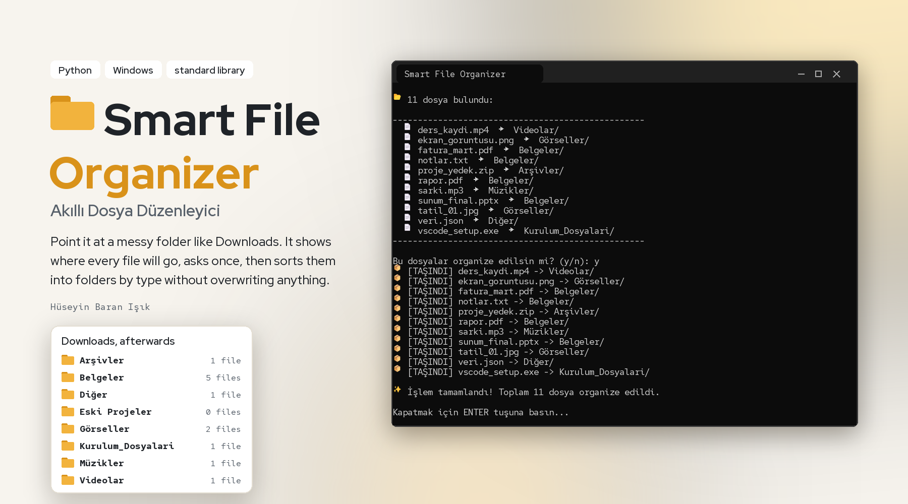
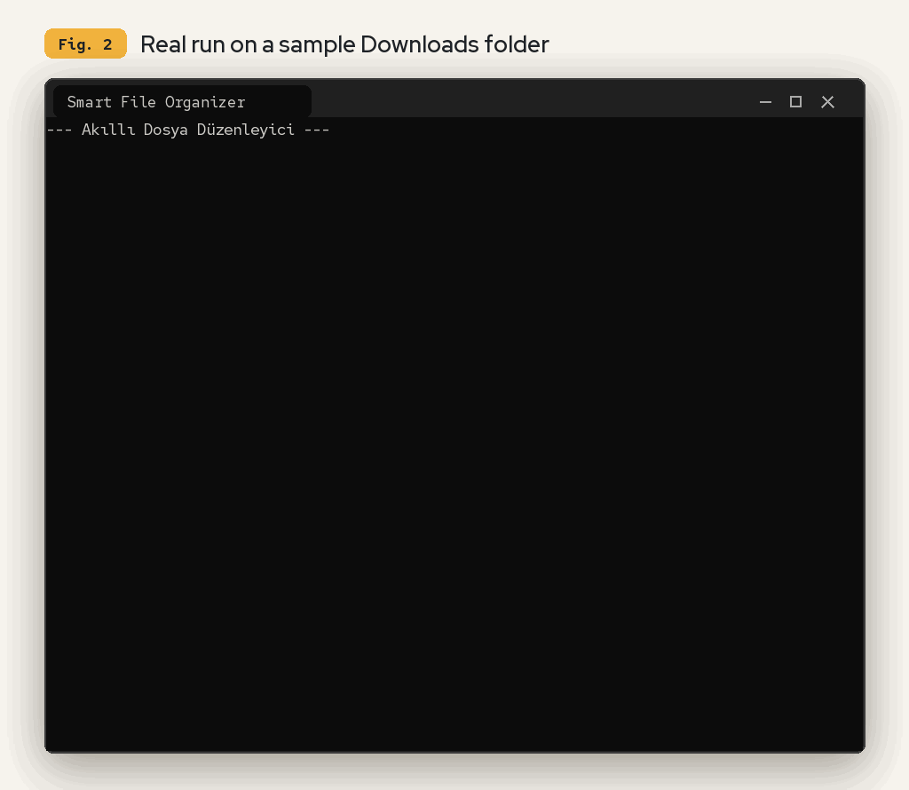
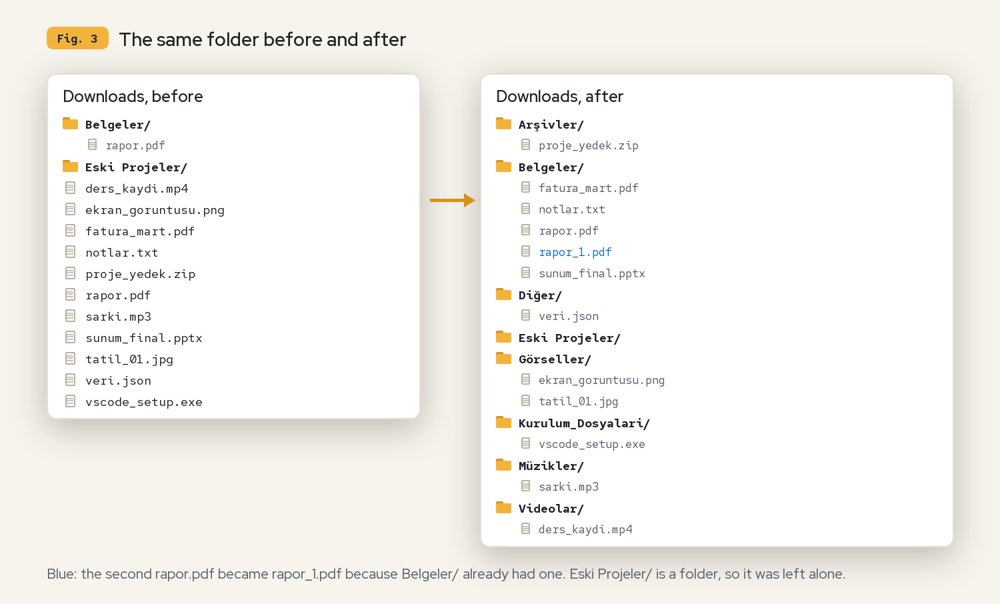
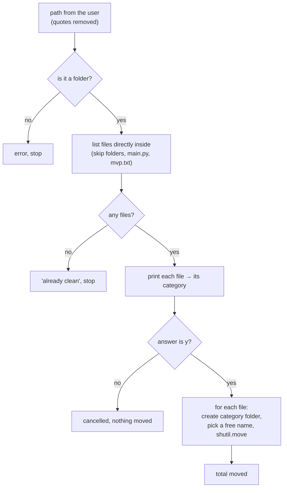

<p align="center">
  
</p>

<p align="center">
  <a href="#demo">Demo</a> &nbsp;·&nbsp;
  <a href="#what-it-does">What it does</a> &nbsp;·&nbsp;
  <a href="#how-it-works">How it works</a> &nbsp;·&nbsp;
  <a href="#run-it">Run it</a> &nbsp;·&nbsp;
  <a href="#known-limits">Limits</a> &nbsp;·&nbsp;
  <a href="#türkçe">Türkçe</a>
</p>

**Smart File Organizer** (*Akıllı Dosya Düzenleyici*) tidies a messy folder such as Downloads. You give it a
folder; it lists every file and the folder it will go to, asks once, and then moves the files into folders by
type. It never overwrites a file and never touches subfolders. It is one Python file that uses only the standard
library.

<br>

## Demo

<p align="center">
  
</p>

This is a real run of `Kaynak_Kodlar/main.py`, unchanged, on a sample Downloads folder.
[`tools/record_terminal.py`](tools/record_terminal.py) builds the folder, types the answers (the path, `y`, Enter)
and records the terminal. Here is what the folder looked like before and after that run:

<p align="center">
  
</p>

<br>

## What it does

<table>
<tr><td width="26%"><b>Sorts by file type</b></td><td>Each file goes to a folder named after its type, created if missing. Anything it does not know goes to <b>Diğer</b> (Other).</td></tr>
<tr><td><b>Shows first, then asks</b></td><td>It prints every file with its target folder and moves nothing until you answer <code>y</code>. Any other answer cancels.</td></tr>
<tr><td><b>Never overwrites</b></td><td>If the target folder already has a file with the same name, the new one is renamed <code>name_1.ext</code>, <code>name_2.ext</code> and so on.</td></tr>
<tr><td><b>Leaves folders alone</b></td><td>Only files directly inside the chosen folder are moved; subfolders and their contents are not touched.</td></tr>
<tr><td><b>Copy-paste friendly</b></td><td>Quotes are removed from the path, so "Copy as path" from Windows Explorer works as is.</td></tr>
<tr><td><b>Reports each move</b></td><td>One <code>[TAŞINDI]</code> line per file, a <code>[HATA]</code> line if a file cannot be moved (the rest continue), and a total at the end.</td></tr>
</table>

### Categories

| Folder | Extensions |
| :--- | :--- |
| Görseller (images) | `.jpg` `.jpeg` `.png` `.gif` `.bmp` `.tiff` `.webp` `.svg` |
| Videolar (videos) | `.mp4` `.mkv` `.flv` `.avi` `.mov` `.wmv` `.mpeg` |
| Belgeler (documents) | `.pdf` `.docx` `.doc` `.txt` `.xlsx` `.pptx` `.csv` `.epub` `.rtf` |
| Kurulum_Dosyalari (installers) | `.exe` `.msi` `.dmg` `.pkg` `.deb` `.rpm` |
| Arşivler (archives) | `.zip` `.rar` `.7z` `.tar` `.gz` |
| Müzikler (music) | `.mp3` `.wav` `.flac` `.m4a` `.aac` |
| Diğer (other) | everything else |

The list is the `CATEGORIES` dictionary at the top of `Kaynak_Kodlar/main.py`; extensions are compared in lower case.

<br>

## How it works



A file's category is the first entry in `CATEGORIES` whose list contains its extension; with no match it is
`Diğer`. The free name is found by trying `name_1.ext`, `name_2.ext`, … until one does not exist.

`Kaynak_Kodlar/installer.py` is a separate Windows installer meant to be packed with PyInstaller: it copies
`SmartOrganizer.exe` to `%LOCALAPPDATA%\SmartOrganizer` and puts a "Smart File Organizer" shortcut on the desktop.

<br>

## Run it

Python 3, no packages to install.

```bash
git clone https://github.com/huseyinbaranisik/Smart_file_organizer.git
cd Smart_file_organizer
python Kaynak_Kodlar/main.py
```

On Windows you can double-click `run.bat`, or run the ready-made `Smart_file_organizar/Smart_File_Organizer.exe`
(no Python needed). Then type or paste the folder's path, check the list, and answer `y`.

> [!WARNING]
> Files are really moved. Try it on a copy of a folder first.

<br>

## Known limits

- **No undo.** There is no log of what moved where, so putting files back is manual.
- **The .exe may be older than the code.** `Smart_File_Organizer.exe` was added on 26 February 2026; `main.py` last
  changed on 2 April 2026.
- **The code is in the repository twice.** `Kaynak_Kodlar/` and `Smart_file_organizar/Kaynak_Kodlar/` are
  currently identical copies.
- **No licence file.** The previous README said MIT, but there is no `LICENSE` file in the repository.
- **Fixed categories.** Changing them means editing `CATEGORIES` in the code.

### Next steps (from `Kaynak_Kodlar/mvp.txt`)

A graphical interface, scheduled cleaning (for example every Friday at 18:00), and sorting by size, date or
keywords.

<br>

## Credits

- Tool by Hüseyin Baran Işık.
- Figures set in Red Hat Display and Red Hat Mono, both under the SIL Open Font License
  ([`tools/fonts/`](tools/fonts/)); terminal emoji from Windows' Segoe UI Emoji, as Windows Terminal shows them.
  Rendered by [`tools/render_figures.py`](tools/render_figures.py).

<br>

---

## Türkçe

**Akıllı Dosya Düzenleyici** (*Smart File Organizer*), İndirilenler gibi dağınık bir klasörü toparlar. Ona bir
klasör verirsin; her dosyayı ve gideceği klasörü listeler, bir kez sorar, sonra dosyaları türlerine göre
klasörlere taşır. Hiçbir dosyanın üzerine yazmaz ve alt klasörlere dokunmaz. Yalnızca Python'un standart
kütüphanesini kullanan tek bir dosyadır.

### Demo

Yukarıdaki GIF (Şekil 2), `Kaynak_Kodlar/main.py`'nin hiç değiştirilmeden örnek bir İndirilenler klasöründe
çalıştırılmasının gerçek kaydıdır. [`tools/record_terminal.py`](tools/record_terminal.py) klasörü oluşturur,
cevapları yazar (klasör yolu, `y`, Enter) ve terminali kaydeder. Şekil 3, aynı klasörün çalıştırmadan önceki ve
sonraki halini gösterir.

### Ne yapıyor

<table>
<tr><td width="26%"><b>Türe göre ayırır</b></td><td>Her dosya, türünün adını taşıyan bir klasöre gider; klasör yoksa oluşturulur. Tanımadığı her şey <b>Diğer</b> klasörüne gider.</td></tr>
<tr><td><b>Önce gösterir, sonra sorar</b></td><td>Her dosyayı hedef klasörüyle yazar ve sen <code>y</code> diyene kadar hiçbir şey taşımaz. Başka her cevap işlemi iptal eder.</td></tr>
<tr><td><b>Üzerine yazmaz</b></td><td>Hedef klasörde aynı isimde bir dosya varsa, yenisinin adı <code>isim_1.uzanti</code>, <code>isim_2.uzanti</code> diye değiştirilir.</td></tr>
<tr><td><b>Klasörlere dokunmaz</b></td><td>Yalnızca seçilen klasörün doğrudan içindeki dosyalar taşınır; alt klasörler ve içleri olduğu gibi kalır.</td></tr>
<tr><td><b>Kopyala-yapıştır dostu</b></td><td>Yoldaki tırnaklar silinir; Windows Gezgini'ndeki "Yol olarak kopyala" olduğu gibi çalışır.</td></tr>
<tr><td><b>Her taşımayı bildirir</b></td><td>Her dosya için bir <code>[TAŞINDI]</code> satırı, taşınamayan dosya için bir <code>[HATA]</code> satırı (diğerleri devam eder) ve sonda toplam.</td></tr>
</table>

Kategoriler ve uzantılar yukarıdaki tabloda; liste `Kaynak_Kodlar/main.py`'nin başındaki `CATEGORIES` sözlüğüdür,
uzantılar küçük harfe çevrilerek karşılaştırılır.

### Nasıl çalışıyor

Akış yukarıdaki Mermaid diyagramında. Bir dosyanın kategorisi, `CATEGORIES` içinde uzantısını barındıran ilk
kayıttır; eşleşme yoksa `Diğer` olur. Boş isim, var olmayan bir isim bulunana kadar `isim_1.uzanti`,
`isim_2.uzanti`, … denenerek bulunur.

`Kaynak_Kodlar/installer.py`, PyInstaller ile paketlenmek üzere yazılmış ayrı bir Windows kurulum programıdır:
`SmartOrganizer.exe`'yi `%LOCALAPPDATA%\SmartOrganizer` klasörüne kopyalar ve masaüstüne "Smart File Organizer"
kısayolu koyar.

### Çalıştırma

Python 3; kurulacak paket yok.

```bash
git clone https://github.com/huseyinbaranisik/Smart_file_organizer.git
cd Smart_file_organizer
python Kaynak_Kodlar/main.py
```

Windows'ta `run.bat` dosyasına çift tıklayabilir ya da hazır `Smart_file_organizar/Smart_File_Organizer.exe`
dosyasını çalıştırabilirsin (Python gerekmez). Sonra klasörün yolunu yaz ya da yapıştır, listeyi kontrol et ve
`y` de.

> [!WARNING]
> Dosyalar gerçekten taşınır. Önce bir klasörün kopyası üzerinde dene.

### Bilinen kısıtlar

- **Geri alma yok.** Neyin nereye taşındığının kaydı tutulmuyor; dosyaları geri koymak elle yapılmalı.
- **.exe koddan eski olabilir.** `Smart_File_Organizer.exe` 26 Şubat 2026'da eklendi; `main.py` en son 2 Nisan
  2026'da değişti.
- **Kod repoda iki kez var.** `Kaynak_Kodlar/` ve `Smart_file_organizar/Kaynak_Kodlar/` şu an birebir aynı.
- **Lisans dosyası yok.** Önceki README MIT diyordu ama repoda `LICENSE` dosyası yok.
- **Kategoriler sabit.** Değiştirmek için koddaki `CATEGORIES` düzenlenmeli.

**Sonraki adımlar (`Kaynak_Kodlar/mvp.txt`'den):** grafik arayüz, zamanlanmış temizlik (örneğin her cuma
18:00'de) ve boyuta, tarihe ya da anahtar kelimeye göre sıralama.

### Teşekkür

- Araç: Hüseyin Baran Işık.
- Figürlerde Red Hat Display ve Red Hat Mono kullanıldı; ikisi de SIL Open Font License altındadır
  ([`tools/fonts/`](tools/fonts/)). Terminaldeki emojiler, Windows Terminal'de göründüğü gibi Windows'un Segoe UI
  Emoji fontundan.
